<a id="top"></a>

<div align="center">
  
</div>

<h1 align="center">gentle-shell-gpui</h1>

<p align="center"><strong>Gentle Shell in a native window: your agents, terminals, files and previews in one desktop app.</strong></p>

<p align="center">
  <a href="https://github.com/Gentleman-Programming/gentle-shell-gpui/releases/latest"></a>
  <a href="https://github.com/Gentleman-Programming/gentle-shell-gpui/actions/workflows/ci.yml"></a>
  <a href="#get-started"></a>
  
  <a href="https://github.com/Gentleman-Programming/gentle-shell-gpui/stargazers"></a>
  <a href="https://github.com/Gentleman-Programming/gentle-shell-gpui"></a>
</p>

<p align="center">
  <strong>
    <a href="https://github.com/Gentleman-Programming/gentle-shell-gpui/releases/latest">Download</a>
    &nbsp;·&nbsp;
    <a href="#get-started">Quickstart</a>
    &nbsp;·&nbsp;
    <a href="#your-workspace">Features</a>
    &nbsp;·&nbsp;
    <a href="#documentation">Docs</a>
    &nbsp;·&nbsp;
    <a href="https://github.com/Gentleman-Programming/gentle-shell">Gentle Shell</a>
  </strong>
</p>

<br>

<p align="center">Your agents shouldn't live in a scrollback.<br><strong>gentle-shell-gpui gives <a href="https://github.com/Gentleman-Programming/gentle-shell">Gentle Shell</a> a native desktop home, built in Rust with <a href="https://gpui.rs">GPUI</a>.</strong></p>

<p align="center"><sub><strong>If the app made your agents easier to lead, a star helps other people find it.</strong></sub></p>

<p align="center"><strong>BUILT ON GENTLE SHELL</strong> &nbsp;·&nbsp; Native GPUI &nbsp;·&nbsp; Workspaces and panes &nbsp;·&nbsp; Generative UI &nbsp;·&nbsp; macOS, Windows, Linux</p>

<p align="center">
  
</p>

## Support the project

<div align="center">

<a href="https://github.com/sponsors/Gentleman-Programming"></a>

<p>
No investors and no paywalls: the Gentleman Programming tools are funded by the people who use them.<br/>
Donations through <a href="https://github.com/sponsors/Gentleman-Programming"><strong>GitHub Sponsors</strong></a> go straight into maintenance and new features.
</p>

<p>Can't donate? A ⭐, a bug report or a pull request helps too.</p>

</div>

<p align="center">
  
</p>

<a id="how-it-works"></a>

## How it works

### One Gentle Shell per tab — The app hosts, Shell does the work

A native desktop app for [Gentle Shell](https://github.com/Gentleman-Programming/gentle-shell), built in Rust with [GPUI](https://gpui.rs) and [GPUI Kit](https://github.com/longbridge/gpui-kit). Use Gentle Shell from a window instead of a terminal. The layout follows [Tern](https://stencil.so/tern): translucent glass chrome, tabs in the title bar, a centered composer, and tool calls shown as cards.

The app does not reimplement Gentle Shell. Each tab starts `gentle-shell --mode rpc` and talks to it over Pi's [RPC protocol](https://pi.dev/docs/latest/rpc), so el Gentleman, ODD, Gentle Agents, permissions, Engram memory, review, skills and every extension run unchanged. The app sets `GENTLE_SHELL_INTERACTIVE_HOST=1`, which enables `ask_user_question` dialogs and the live helper activity feed. Gentle Shell's own screens are terminal-UI components that never reach an RPC host, so the app rebuilds them natively from the same files and events.

<details>
<summary><kbd>More</kbd> <strong>Limits of an RPC host</strong> — what a window can't do that the terminal can</summary>

<br>

- With a Gentle Shell older than 4.8 (no Desktop channel): no model, tokens or cost for live helpers, no Claude subscription windows, and helpers and background jobs can only be stopped by the agent.
- Auto permission mode may refuse actions: Gentle Shell does not count RPC input as a live human decision.

</details>

<p align="right"><a href="#top">Back to top ↑</a></p>

<p align="center">
  
</p>

<a id="your-workspace"></a>

## Your workspace

### Workspaces and tiling — Every project in its place

Named workspaces (each with its own folder and tabs), saved and restored; agents in other workspaces keep running while you switch. A dot on the workspace chip says an agent in another workspace is working (accent) or needs you (amber), and the switcher (⌃⌘K) shows which: "working" or "needs you" on each workspace.

<details>
<summary><kbd>More</kbd> <strong>Switching, panes and tiling</strong></summary>

<br>

Tabs split into panes: agent, terminal or file. Panes tile like Hyprland's dwindle: ⌘D adds a pane by splitting the focused one along its longer side, so panes spiral in instead of lining up in one row (a pane too small to halve opens the new one as a tab). Split right and split down (⌘⇧D) stay in the palette and menu. Panes have no header: new pane, split down and close pane (⌘W) sit in the title bar and act on the focused pane; hovering the close button marks the pane it would close, and its tooltip names it. Closing an agent that is working or waiting for your answer asks first. Every close can be undone: the notice that follows reopens it, and so does ⌥⌘T (Ctrl+Alt+Shift+T elsewhere, also in the palette and menu), most recent first: agents come back with their conversation, in the same place in the layout. ⌘] / ⌘[ move focus. Drag a divider to resize. Drag a pane's grip onto another pane: near an edge it moves to that side (the zone lights up), in the middle the two swap. ⌃⌘K switches workspace. The sidebar remembers whether it was open.

</details>

---

### Terminal panes — Your login shell, in a real PTY

Your login shell in a real PTY (alacritty_terminal) with the Gentleman colors; ⌘⇧T opens a terminal tab.

---

### Files sidebar (⌘B) — Files, changes and branches beside the agent

Files, Changes and Branches tabs. The tree respects `.gitignore` (⋯ → Show Ignored Files lists the rest dimmed), navigates with the arrow keys, and has New File / New Folder buttons with inline naming. The ⋯ menu also opens the workspace folder in any code editor installed on macOS, Windows or Linux (VS Code, Insiders, Cursor, Windsurf, Kiro, VSCodium, Zed, Sublime Text, Xcode, Visual Studio, Android Studio, IntelliJ IDEA, WebStorm, PyCharm, GoLand, RustRover, CLion, PhpStorm, Rider, Nova, BBEdit), found in the usual install folders, JetBrains Toolbox, Flatpak, Snap or the PATH.

<details>
<summary><kbd>More</kbd> <strong>Tree, editors, changes, branches and file viewer</strong></summary>

<br>

Right-click a row for Open, Open to the Side (⌘↵), Open in New Tab (⌥⌘↵), Open with Default App, Insert Path into the agent prompt (⌥↵), Copy Path (⌥⌘C) / Relative Path (⌥⇧⌘C), Reveal in Finder (⌥⌘R), Rename (F2), Duplicate, Cut / Copy / Paste (⌘X / ⌘C / ⌘V) and Move to Trash (⌘⌫). A click on a file opens it in the tab's preview pane (a pane too small to split opens it as a tab); clicking another file swaps it in place, and the ✕ at the right of the file header closes the pane (asking first when it has unsaved edits). Files open in a syntax-highlighted editor: ⌘S saves atomically, a dot marks unsaved edits, outside writes reload a clean buffer and ask (Reload / Keep mine) when you have unsaved edits, and closing a pane or tab with unsaved edits asks first. Markdown files open rendered, with an Edit · Split · Preview toggle in the file header; the preview follows unsaved edits live (relative images load from the file's folder) and the last choice is remembered for the session. ` ```mermaid ` blocks are drawn as diagrams in the app's light or dark theme, natively, without a browser, by a diagram renderer the app downloads the first time you ask for it (merman's CLI, ~20 MB, not part of the app); until then the preview shows them as source and offers the download. One that can't be drawn stays as source with the reason under it. A link to another Markdown file opens it in the same pane; other local files open in their default app. YAML front matter shows as a block at the top. Changes open as a read-only diff against HEAD. **Changes** (after Tern): Unstaged and Staged lists (or by folder) with a checkbox per file, Stage all / Unstage all, stash, discard on right-click, and a commit box (summary, description, Amend, Commit / Commit & Push with ⌘↵); "Generate message" asks your Gentle Shell (`--print --no-session --no-tools`) for a Conventional Commits message from the staged diff. **Branches**: filterable branches, remotes, tags, stashes (apply / pop / drop), worktrees and submodules; click a branch to check it out; the footer shows upstream and ↑ahead ↓behind. Worktrees: click one to open an agent tab in it; right-click to remove it (or prune it once its folder is gone). Right-click a branch → New worktree, or type a new branch name in the filter → New worktree on branch “name” (from HEAD); either way it goes in `<repo>.worktrees/<branch>` next to the repository and opens an agent tab there.

</details>

---

### Commit history — The branch as a graph

A pane beside your work (like a file preview: it splits the largest pane or takes the place of the tab's history pane, and is restored with the workspace) with the branch's commits as a graph: each merged branch in its own colored lane, forking out of the merge and joining where it started, labeled with its name (from the merge's subject or a branch ref); tags as chips; HEAD as a ring and uncommitted changes as a dashed one above it.

<details>
<summary><kbd>More</kbd> <strong>Lanes, cards and actions</strong></summary>

<br>

Rows show the subject (merged-in commits dimmed), the author's initials and name (a dot marks a co-author such as Claude) and how long ago. Hover a row for its card: author and co-authors, full subject, hash, files changed with +/−, when and on which branch. The branch picker shows any local branch without checking it out; the first 200 commits load, and "Earlier history" loads 200 more. Click a commit to select it and copy its hash.

</details>

---

### Command palette (⌘K) — Every command, one keystroke away

Categories: All, Commands, Workspaces, Files, Branches. Includes every Gentle Shell slash command and skill. ↑↓ move, ↵ runs, Tab or ←→ (while the search is empty) switch category, Esc closes. Gentle Shell commands whose screen only exists in the terminal open the app's own: `/gentle:usage` and `/gentle:stats` open Usage (Subscription / Local stats), `/gentle:agents` the Agents window and `/gentle:jobs` its Jobs tab, `/gentle:profiles` (no arguments) Profiles, `/gentle:commands` ⌘K, `/gentle:changes` Files › Changes.

<details>
<summary><kbd>More</kbd> <strong>Categories and Gentle Shell commands</strong></summary>

<br>

`/gentle:customize`, `/gentle:guide`, `/gentle:voice`, `/gentle:music`, `/gentle:panel` and `/history` do nothing over RPC and are hidden. Double-click an agent tab to rename its session.

</details>

---

### Sessions (⌘⇧O) — Pick up any conversation

Resume previous conversations for this project or any project; sessions from another project open in a new tab. ⌘N starts a new session. With a Gentle Shell newer than 4.8 (its `main`), the active agent tab's Shell lists them itself (`list_sessions`, 50 at a time with **Load older sessions**) and opens one by id in that tab (`switch_session`); 4.8 and older keep reading the session files.

---

### Instances — What agents open, out of your way

What agents open (dev-server pages, `gentle-open`, the design canvas, emulators and simulators they boot) never pops up over your work: a circle in the title bar counts them, its badge colored by the one that most needs a look (red error, gold booting or waiting, green ready).

<details>
<summary><kbd>More</kbd> <strong>The instance tray</strong></summary>

<br>

Click it for the list: each row shows the device or page, the agent tab that opened it, its status and, for devices, the last command the agent ran on it (`adb shell input tap …`, `simctl openurl …`, `maestro test …`). Click a row to open its card, the eye to show or hide it, ⏻ to stop a device or × to close a page; Hide all puts every card back. A hidden page has no web view (and no web process) until you open it, and loads afresh then.

</details>

---

### Notifications (🔔) — One inbox for extension notices

Extension notices go to a notification center instead of piling up as toasts; only warnings and errors still toast. The badge counts unread notices, repeats collapse into `×N`, and clicking a notice jumps to the pane that raised it.

<p align="right"><a href="#top">Back to top ↑</a></p>

<p align="center">
  
</p>

<a id="the-conversation"></a>

## The conversation

### Start screen — The rose, written in

Gentle Shell's rose and pixel wordmark, written in like the terminal intro. It follows `banner.json` (`showRose`, `showTextLogo`, `color`).

---

### Conversation — Streaming answers and live tool cards

Streaming Markdown, collapsible thinking, and tool cards (`Edit path +12 −3`, `Bash …`) with live output. Helper answers (`gentle-agents.result`) appear as Markdown cards titled with the agent and its status; background job notices show their label, exit code and output tail; Gentle Shell's review preflight, exploration budget and verification reminders get named cards.

<details>
<summary><kbd>More</kbd> <strong>Cards, copy and the message rail</strong></summary>

<br>

A slash command's text output appears as one result card. Hover an answer, or a message you sent, for Copy. When the conversation is longer than the pane, a rail on the right edge marks every message you sent, placed by the heights it has seen (rows not shown yet count as the average), and shows a scroll thumb while you scroll or point at it (the one you are reading highlighted, its first line on hover); click a mark to glide to it, and a ↓ button glides back to the latest output. Both hide when everything fits.

</details>

---

### Composer — Steer, stop and run commands

Enter sends; while the agent runs, Enter steers it and ⌘. (Ctrl+. elsewhere) or the Stop button stops it. `!cmd` / `!!cmd` run shell commands; the Stop button and ⌘. stop a running one too (`abort_bash`). `/` lists commands (↑/↓ move through them, Tab or Enter fills one in, Esc closes the list), including Pi's built-ins: `/compact [what to keep]`, `/name <title>`, `/copy`, `/export [path]` (HTML) and `/reload` (restarts the backend and resumes the conversation).

<details>
<summary><kbd>More</kbd> <strong>Slash commands, context and effort</strong></summary>

<br>

Click the context percentage to compact now or turn auto-compaction on or off. For reasoning models, the effort chip (the level's icon, the level and a pixel meter) opens a slider in Gentle Shell's rose gradient with one stop per level the model accepts (`get_available_thinking_levels`: off … high, and xhigh / max where supported): click, drag or pick a label; the card says what the level costs, and the icon follows the level (moon, feather, leaf, brain, circuit brain, bolt, flame). Every level plays its own surge over the window, and each one builds on the level below until max: minimal and low send a pixel comet along a quarter and half of the window's edge; medium runs the whole lap and the edge flares; high adds energy spiralling into a glowing core while the window trembles; xhigh trembles harder and hatches the core with a flash, a shockwave and a shower of sparks; max (about 4 seconds) goes all the way: one last jolt and Gentle Shell's pixel rose bursts out with a rebound. Off plays nothing. Shows model, effort, context %, cost, the ODD phase (`✿ exploring…`), extension statuses, queued messages and running jobs.

</details>

---

### Attachments — Images and long pastes

Attach images with 📎, by pasting (screenshots or copied image files) or by dropping them on the composer. PNG, JPEG, GIF and WebP go as they are; BMP and TIFF (what Windows' Snipping Tool and Print Screen copy) are converted to PNG.

<details>
<summary><kbd>More</kbd> <strong>Formats, tokens and paste chips</strong></summary>

<br>

Each image becomes an `[Image #N]` token and a thumbnail, and the agent receives the images with the prompt. Models without image input and `!cmd` shell commands refuse image attachments with a warning. A long paste (6 lines or more, or 800 characters or more) doesn't flood the composer: it becomes a 📄 `#N` chip where it was pasted and a card showing the start of the text, `#N` and its line count. Remove the card or delete the chip to drop it; the agent receives the full text in its place. In the conversation, a long message you sent shows its first lines and "N more lines" to unfold it.

</details>

---

### Session chips — What the session tracks, above the composer

As in Tern, what a session tracks sits in chips over the composer instead of a side panel, so every pane keeps its full width: background **Jobs**, **Helpers 1/3** (each subagent's status, task and last step, with a button to the full Agents window), extension widgets and the last response's tokens.

<details>
<summary><kbd>More</kbd> <strong>Jobs, helpers and the Todos island</strong></summary>

<br>

Click a chip for its card. The task list is a Dynamic-Island-style pill at the top of the conversation: when a session has tasks, **Todos 2/7** appears there with a small progress equalizer. Click it to unfold the task list downward over the conversation, then click again to fold it; the list shows each task's status (done, in progress, pending, blocked, dropped) and note. It floats over the chat, so the conversation never moves, and nothing is added around the composer.

</details>

---

### Changed in this session — The files this session touched

A chip over the composer, with a Gentle Shell newer than 4.8.0: the files the agent's session changed (its repository and its helpers' worktrees) with `+`/`−` counts; click one for its diff in the app's diff viewer. Refreshed at each turn end. Files › Changes stays the repository's own Git view. Hidden on 4.8.0.

---

### Sounds — Gentle Shell's tones, when you want them

App tabs follow Gentle Shell's `notifications.json` (the file `/gentle:customize` edits in the terminal; Configuration › Notifications). Off by default. When on, a finished turn, a question for you, or context ≥ 90% plays Gentle Shell's tones (macOS `afplay`, Windows PowerShell `SoundPlayer`, Linux `paplay` / `pw-play` / `aplay` when installed, otherwise silent) and bounces the Dock or flashes the taskbar while the app is in the background.

<p align="right"><a href="#top">Back to top ↑</a></p>

<p align="center">
  
</p>

<a id="generative-ui"></a>

## Generative UI

### Diagrams — Plan a system on a live canvas

Not only a chat: when you plan an architecture, a data flow or anything with many interacting parts, the agent can show an interactive diagram right in the conversation (its `gentle_ui` tool, from a Pi extension the app ships and loads into every agent tab).

<details>
<summary><kbd>More</kbd> <strong>Canvas, editing and layout</strong></summary>

<br>

Services, databases, queues, caches, clients and external systems in groups, with sync, async, data and dependency connections, laid out automatically with few crossings, on a React Flow–style canvas: dotted grid, node cards with handles, flowing async and data edges, zoom controls with a lock and a minimap. Pan, zoom (⌘/Ctrl-scroll, pinch, + − fit), select a part for its details, shift-drag to select several, drag nodes (into or out of groups), double-click to rename, drag from a handle to connect, edit a node's kind, status, group, tech and description, create, rename and ungroup groups, flip the direction, delete, add nodes, undo and redo; your edits pile up as "N changes" until you Send to agent (with an optional note), and the agent sees them as a list ("moved Cache next to API", "connected API → Queue") with the full diagram. If the agent can't take them (it changed the diagram meanwhile), the card says why and keeps them for Retry. "Ask about this" puts the selected part in the composer, and Expand gives the diagram the conversation's whole space. When the agent updates it, the changes ease in and your view stays where you left it.

</details>

---

### Tables, forms, checklists, boards and charts — Native panels when text isn't enough

The same `gentle_ui` tool shows native panels when they fit better than a diagram: a table you sort, filter, select rows in and (when the agent allows it) edit; a form whose answers go to the agent at once when you submit, then stay read-only until it asks again; a checklist you check off, rename, add to, indent and reorder by dragging; a kanban board whose cards you drag between columns, add and edit; and bar, line, area, pie, donut and scatter charts with values on hover and "Ask about this" on a click.

<details>
<summary><kbd>More</kbd> <strong>What each panel does</strong></summary>

<br>

Edits pile up as "N changes" until you Send to agent and, like the diagram's, stay for Retry if the agent can't take them; everything animates gently and stays still with reduced motion.

</details>

---

### Run plans, subagent boards and live panels — Panels that drive the agent

Panels can drive the agent and stay current. Turn a checklist into a run plan: skip or reorder steps, press Run or Run next, and the agent does the next step and reports each one back (running, done, failed). Drag a card into a board's "start" column and the agent dispatches a subagent for it; the card then shows that subagent's live status, step and cost, with Stop.

<details>
<summary><kbd>More</kbd> <strong>Run plans, boards and live data</strong></summary>

<br>

Tables, charts and checklists can be live, filled by the app from the session's jobs, subagents or todo list, the folder's git status or log, or a command the agent proposes (it runs only after you allow it on the card, every few seconds while the card is on screen); "Live · updated 5 s ago" with Pause. The Todos island can show the agent's todo list as a checklist.

</details>

---

### Change review — Accept or reject each hunk

Before writing a large or risky change (or every change, when you ask for review mode), the agent can show it as a review (`gentle_ui` kind `review`): its files and hunks in the app's diff viewer, with syntax colors. Accept, reject or comment each hunk (or a whole file, or everything) by clicking or with j/k, a/r, c; "5 of 9 hunks decided" tracks it, and Send decisions tells the agent exactly which hunks to apply and which comments to address.

<details>
<summary><kbd>More</kbd> <strong>How a review works</strong></summary>

<br>

The agent writes only what you accepted and the card then marks those hunks Applied. It can also wait for your decisions within the same turn.

</details>

---

### Sequence diagrams, data models, state machines and timelines — Four more kinds on the canvas

Four more `gentle_ui` kinds on the diagram's canvas (pan, zoom, fit, minimap): sequence diagrams whose participants and messages you reorder by dragging, add messages to by dragging from one lifeline to another and retype (sync, async, return); data models (ERD) the agent derives from your migrations or ORM models, with keys, crow's-foot relations you draw by dragging between columns, and tables you move, rename and add columns to; state machines with the current state highlighted, edited like a diagram; and Gantt timelines with a date axis and a today line, whose bars you drag to move or resize, link into dependencies and see the critical path and late tasks of.

<details>
<summary><kbd>More</kbd> <strong>What each kind does</strong></summary>

<br>

Edits go to the agent like the panels'.

</details>

---

### HTML pages — Custom visuals, sandboxed

For a custom interactive visual (a simulation, a calculator, a quick prototype) the agent can write a page (`gentle_ui` kind `html`). It appears as a card in the conversation; Open runs it in place of the conversation, themed like the app, in an isolated web view: no network unless the agent declares the origins (the card says which), no access to your files or the app.

<details>
<summary><kbd>More</kbd> <strong>Isolation and messaging</strong></summary>

<br>

What you do there can message the agent, share context it reads on its next turn, or ask to open a link (you confirm; it opens in the in-app browser). The page speaks the MCP Apps protocol, so it also works in other MCP Apps hosts.

</details>

---

### Code links, pinning, export and templates — From the panel back to the code

Items the agent shows that are code (diagram nodes, data-model tables, table rows, checklist items, kanban cards) link to it: click `file.rs:42` to open it in the file viewer at that line, or right-click to open it in your editor; missing files show muted.

<details>
<summary><kbd>More</kbd> <strong>Links, pinning, export and templates</strong></summary>

<br>

Pin any surface to a side panel of the tab so it stays in sight while you scroll, with the agent's updates arriving live (several pinned show as tabs, and they come back when you reopen the conversation). Export a diagram as Mermaid or SVG, a sequence diagram, data model, state machine or timeline as Mermaid, a table as Markdown or CSV, a checklist or board as Markdown, a chart as PNG or CSV, a form's answers as JSON, a page as HTML or a change review as a patch: copy it, save it (into the project's `docs/` by default) or ask the agent to add it to the docs. Save any surface as a template and insert it into another conversation with `/ui-template`.

</details>

---

### Agent UI setting — When the agent reaches for a panel

The agent reaches for these surfaces on its own when one clearly beats a text answer (Proactive, the default): a diagram when it explains or proposes a system with four or more interacting parts, a run-plan checklist for a plan of four or more steps it will carry out, a table to compare three or more options, one form when it needs two or more decisions from you, a chart for numbers, a review before multi-file or risky edits, and sequence diagrams, data models, state machines and timelines where they fit.

<details>
<summary><kbd>More</kbd> <strong>Proactive, When asked and Off</strong></summary>

<br>

Never for short answers, small edits or when you want text only; an open surface is updated rather than shown again, and at most one new one per reply. Configuration → Agent UI switches between Proactive, **When asked** (only when you ask for one) and **Off** (the agent has no `gentle_ui` tool; surfaces already shown stay and Insert UI template still works). Every open tab follows a change from its next turn; saved in the app's `settings.json` (`genuiMode`).

</details>

<p align="right"><a href="#top">Back to top ↑</a></p>

<p align="center">
  
</p>

<a id="agents-and-control"></a>

## Agents and control

### Agents (⌘⇧A) — Every helper, live

Gentle Agents helpers: status, last step and the thread (Activity tab). With Gentle Shell 4.8+ the list comes from its Desktop channel (`list_subagents` and live `agents_update`), with each helper's model, tokens and cost, and **Stop** cancels it host-side (`cancel_subagent`); the thread, prompt and live progress still come from Shell's `gentle-agents` activity widget, joined by task id.

<details>
<summary><kbd>More</kbd> <strong>Desktop channel, jobs and background subagents</strong></summary>

<br>

With an older Shell the list falls back to that widget alone (time, turns, tools) and "Ask to stop", which asks el Gentleman to run `subagent_cancel`. The Jobs tab lists every background job, with a cancel button on running ones when Shell offers `cancel_job`. Configuration → Background subagents (Off / On) runs Gentle Shell's own `/gentle:background-subagents enable|disable` in the active agent tab: with it on, helpers start in the background and their answers arrive when they finish. The row shows which source decides (project file, global file, `GENTLE_PI_BACKGROUND_SUBAGENTS`, default), in the shell's order.

</details>

---

### Profiles — Model and effort per agent

`/gentle:profiles` rebuilt: profiles, per-agent model, effort and Fast tier. Supports Use in this session, Make default, Publish and Clear binding. With Gentle Shell 4.8+ every edit is a `set_config` through its Desktop channel, guarded by the store's revision (a concurrent change is re-read, never overwritten), and Make default / Use in this session run Shell's own `apply_profile`, showing its confirmation exactly; an older Shell keeps the direct file writes.

<details>
<summary><kbd>More</kbd> <strong>Editing, pickers and import/export</strong></summary>

<br>

A route's model picker searches by name, id or provider (every word must match: `bridge opus`), groups models by provider, and takes ↑/↓, Enter and Esc; a custom model id is the last row. The effort menu opens in the same style. ⬇ / ⬆ next to the profile list import and export one profile in Gentle Shell's export format (`gentle-pi.agent_model_profile`): export suggests `profiles.export.json` in the config home, the file `/gentle:profiles import` reads in a terminal; importing a name that exists asks before replacing it.

</details>

---

### Permissions — Normal, Auto, YOLO or Super YOLO

Normal / Auto / YOLO / Super YOLO picker. With Gentle Shell 4.8+ the live mode and the default come from Shell (`get_permission_mode`), and the choice applies to the live session through `set_permission_mode` (and is saved as the default), with no restart; an older Shell gets the previous behavior: the app reads and saves `permission-mode.json` and starts a new session.

<details>
<summary><kbd>More</kbd> <strong>Live modes and older Shells</strong></summary>

<br>

With a Gentle Shell newer than 4.8.0, a mode changed in the terminal (`/gentle:mode`, `/gentle:yolo`) moves the chip too, and an edit to the profiles made outside the app (an editor, `/gentle:profiles`) reaches an open Profiles screen.

</details>

---

### Review mode — Receipt-driven development, one click away

Beside the permission chip, with a Gentle Shell newer than 4.8.0: "Review on / off" for receipt-driven development, what decides it (the default, this repository, or machine-wide), and Turn on / Turn off for this repository or for all of them. Gentle Shell's own confirmation is shown as sent and nothing changes until you approve it. Hidden on 4.8.0 or without `gentle-ai`.

---

### Providers (🔑) — Sign in once, from the app

Sign in with a subscription (Claude Pro/Max, ChatGPT, Copilot, …) or an API key (DeepSeek, OpenAI, Gemini, …), or sign out. It runs Pi's own `ModelRuntime.login` through a small Node helper, and Pi writes `auth.json` as `/login` does.

<details>
<summary><kbd>More</kbd> <strong>How sign-in works</strong></summary>

<br>

A running backend only reads credentials when it starts, so signing in or out restarts the open agent tabs and resumes their conversations (a tab mid-turn waits for the turn to end); the model picker then lists that provider's models.

</details>

---

### Usage & stats — Subscription windows and local cost

Subscription windows and local token/cost stats, in place of `/gentle:usage` and `/gentle:stats`. With Gentle Shell 4.8+ the windows come from Shell itself (`get/refresh_subscription_usage` and `rate_limit` events), Claude's 5h/7d included; an older Shell keeps the app's own ChatGPT/Codex and NaN requests.

<details>
<summary><kbd>More</kbd> <strong>Where the numbers come from</strong></summary>

<br>

With a Shell newer than 4.8 (its `main`), Local stats come from Shell's own `/gentle:stats` aggregation (`get_usage_stats`: totals, models, projects, daily tokens); 4.8 and older keep the app's scan of the session files.

</details>

<p align="right"><a href="#top">Back to top ↑</a></p>

<p align="center">
  
</p>

<a id="build-test-and-preview"></a>

## Build, test and preview

### Gentle Design — The design canvas, in a floating card

When Gentle Shell's design canvas opens (`/gentle:design`, or the model's `gentle_design` tool), it waits in the title bar's instance tray (see Instances); open it from there and it shows in a floating browser card, bottom-right by default: drag its header to move it, any edge or corner to resize it, double-click the header or use the button to maximize it.

<details>
<summary><kbd>More</kbd> <strong>The card and its web view</strong></summary>

<br>

The page stays live while you resize, and the card lifts while you drag it. The canvas reloads itself as artboards change, so the card follows the design live; comments and Implement on the canvas go back to the conversation as usual. Reload, open in your browser and hide are in its header; it closes when the canvas stops. The page is the system's web view: WKWebView on macOS, WebView2 on Windows (in a popup that follows the window, since GPUI draws above child windows; rounded on Windows 11), WebKitGTK on Linux under X11 (on Wayland, which has no child windows, the card says so and the canvas stays in your browser). Gentle Shell also opens its own browser tab the first time, since it has no setting to skip that. The embedded page draws above the app's own menus, so it hides while a screen (palette, settings, …) is open.

</details>

---

### Web apps — Dev servers in the in-app browser

The in-app browser is not only for Gentle Design. `gentle-open <url>` is a shim installed at startup on the PATH the agents receive, so the model can open any http(s) page from its shell tool; the app forwards it to the running window through the single-instance server and keeps it in the instance tray.

<details>
<summary><kbd>More</kbd> <strong><code>gentle-open</code>, loopback URLs and cards</strong></summary>

<br>

A loopback dev-server URL printed by a shell tool (`http://localhost:5173`, `127.0.0.1`, `[::1]`) goes to the tray too. `/web <url>` from the composer shows the card at once. **Each different URL gets its own card**; the same URL reuses it. Web and device cards tile side by side (the hybrid web + mobile case), and the design canvas keeps its own card too. Public URLs need the explicit tool.

</details>

---

### Devices — Simulators and emulators inside the app

iOS simulators and Android emulators inside the app, live and touchable, as tabs in a device panel docked at the right (or floating; a button switches). Configuration → Devices: **Use devices** installs Expo's device hub (the one T3 Code uses) into the app's folder; the panel's + lists every simulator and emulator and boots the one you pick headless, with its screen streamed live and touch, keyboard and hardware buttons.

<details>
<summary><kbd>More</kbd> <strong>Device hub, agents and the panel</strong></summary>

<br>

**Agents can use devices** gives new agent sessions `gentle-device` (open a device in the panel) and `agent-device` (launch apps, tap, type, take screenshots), and tells them to use only those, so a device never opens in a separate Simulator or emulator window. A device an agent starts with its own `simctl boot` or `emulator -avd` still opens in the panel. Every agent is also told to open web pages with `gentle-open`, in the app's browser. The ⏻ in the panel header shuts down the device you're looking at; closing its tab leaves it running (agents may still use it). Devices the app booted are shut down when it quits. Needs Node 22.12+; iOS needs Apple silicon and Xcode; Android needs the SDK and, for emulator video, ffmpeg (the section offers the install command).

</details>

---

### UI testing (Maestro) — Maestro, installed and connected for you

Settings → UI testing · Maestro shows what is installed (CLI, Java, whether the agent has the tools) and does everything from there: Install (or Connect to the agent when Maestro is already there), Test connection (starts the server the way the agent would: `maestro: connected, 10 tools`), Disconnect, Remove (disconnects and deletes the Maestro and Java the app installed; your own installs stay), with a live log.

<details>
<summary><kbd>More</kbd> <strong>Install, connect and remove</strong></summary>

<br>

Connecting or disconnecting reloads open tabs once their turn ends, so the agent picks the change up. The app puts a Java runtime (Temurin 21 JRE from Adoptium, only when there is no Java 17+) and the Maestro CLI (GitHub release, ~350 MB) in its own toolchain folder, both checksum-verified and without `sudo`, on macOS, Linux and Windows. Then it runs `gentle-shell mcp add maestro`, so the agent gets Maestro's tools (`mcp__maestro__*`) in new sessions (or after `/reload`): `list_devices`, `take_screenshot`, `inspect_screen` and `run` (Maestro commands and flows: launch apps, tap, type, swipe, assert), on Android emulators, iOS simulators and web pages (a Chromium Maestro manages; web support is beta in Maestro). The `maestro` command is also on the agent's shell PATH.

</details>

---

### Architecture docs (⌘K) — Docs as code, kept current

One screen for documentation as code in the workspace's `docs/`: ADRs, C4 diagrams, data model, states, flows, runbooks and more, written and kept current by the agent through the [`architecture-docs` skill](https://github.com/ismaelosuna7824/gentle-architecture-docs).

<details>
<summary><kbd>More</kbd> <strong>The architecture-docs skill</strong></summary>

<br>

It installs what is missing (the skill into Gentle Shell, the diagram renderer into the app), starts agent tabs that document the project, a feature, a decision (ADR) or what the code changed, and lists every document as current, stale, unverified or with issues (the skill's `docs-check`), each opening on click.

</details>

<p align="right"><a href="#top">Back to top ↑</a></p>

<p align="center">
  
</p>

<a id="make-it-yours"></a>

## Make it yours

### Configuration — Your Gentle Shell setup, in one place

Your existing Gentle Shell setup: home, models, profiles, sign-ins, permission mode, persona, MCP, packages (install and remove), Claude bridge plan, and the theme picker: Gentle Shell's themes, your Pi themes (`<agent dir>/themes/`), popular terminal schemes, the solid **Studio** and **Studio Light** (a sober, high-contrast pair whose panes stay opaque at any transparency, for a professional, glass-free look), the warm solid **Clay** and **Clay Light** (a calm, cream-and-terracotta pair with an amber accent, also opaque at any transparency) and **OLED Black** (true black that stays solid at any transparency, so an OLED screen keeps those pixels off; soft pearl text and the Gentle rose), applied app-wide and to terminals, remembered across launches.

<details>
<summary><kbd>More</kbd> <strong>Themes, transparency, interface size and more</strong></summary>

<br>

A Transparency slider (default 60%; 15% on Linux, where the desktop usually isn't blurred behind the window) sets how much of the blurred desktop shows through the window, as in Tern; menus, the palette and screens such as Profiles stay solid at any setting, and a theme can ask for fully solid surfaces itself (`"solid": true`, as Studio does) so the slider has no visible effect on it. **Interface size** (80–150%, default 100%, in 10% steps; ⌘= or ⌘+ bigger, ⌘- smaller, ⌘0 back to 100%, Ctrl on Windows and Linux, also in the app menu) scales text, spacing, the window chrome, screens and terminals in every window, remembered across launches (`interfaceScale` in the app's `settings.json`; a hand-set `1.25` matches a desktop scaled to 125% that the app doesn't see, as under WSLg). **Setup & requirements** is the first-run checklist, always here: the same checks, installs, terminal commands and sign-in. When a newer Gentle Shell is published, a card offers Update now (runs `gentle-shell upgrade`), Release notes and Skip this version. When the upgrade ends the card says how it went, from what the app actually runs afterwards: installed (open agent tabs restart on it and resume their conversations; a tab mid-turn switches when the turn ends), installed but an older launcher still comes first (with the command to remove it), or failed (with Gentle Shell's output). With a Gentle Shell newer than 4.8 (its `main`), the active agent tab's Shell answers whether there is one (`get_update_status`; the header's reload looks it up again), and also shows a newer Pi or `main` commit with the command to run, and marks packages with a newer version (**update**) with an **Update packages** button (`gentle-shell update --extensions`). Otherwise the check mirrors the launcher's own startup check: npm `gentle-pi/latest`, stable versions only, with the cache and the skipped version shared with the terminal in `~/.gentle-shell/config.json`; a "newer" answer holds for a day, a "nothing newer" is asked again after an hour, so a release shows the same day. When a newer **Engram** is out (its GitHub releases), a second card offers Update now (`brew upgrade` for Homebrew's Engram, else the release binary), Release notes and Skip this version. Agent tabs run Gentle Shell's self-contained install when there is one (`~/.gentle-shell/bin/gentle-shell`; `%LOCALAPPDATA%\gentle-shell\bin\gentle-shell.cmd` on Windows), which `gentle-shell upgrade` sets up since 4.7, ahead of an older global `gentle-pi` on your PATH; otherwise whichever `gentle-shell` is on your PATH, so updating outside the app works too.

</details>

---

### Animated theme backgrounds — Live scenes behind the glass

Like Claude Desktop's custom themes: an app theme can put an animated scene behind the glass panes, plus a sky gradient or an image (animated GIFs play). A scene is JavaScript run in a sandbox (embedded QuickJS: no files, network or timers; each frame is time-boxed and memory is capped), drawing pixels (shapes, text, glows, gradients) or ASCII cells and sprites.

<details>
<summary><kbd>More</kbd> <strong>Scenes, sandbox and sharing</strong></summary>

<br>

13 themes ship with scenes (Aurora, Petals, and Moonlit, Koi Pond, Sakura Dusk, Neon Rain, Jellyfish, Lantern Night, Fireflies, Snow Cabin, Star Voyage, Honu Lagoon and Cloud Drift adapted from [claude-desktop-themes](https://github.com/0toshigami/claude-desktop-themes), MIT), whose live wallpapers also run unchanged. Ask any agent for one ("a theme with koi in a pond, in my colors"): every agent is pointed at `<data dir>/gentle-shell-gpui/themes/GUIDE.md` and writes the theme and its scene there; a failing scene leaves `scene-error.txt` with the error and line. Theme folders are watched, so new or edited themes appear within seconds. **Share** saves a theme as one `.gentletheme` file (scene and image inside); import one with **Import…**, a link, or by dropping it on Configuration › Theme. Cost: a scene's script runs on its own thread and is held under 8% of one core (heavier scenes show fewer frames, down to 8 fps); scenes move only while the window is in front and hold still with reduced motion. **Scene motion**: Calm (default, up to 12 fps; about 10% of one core on an M-series Mac, measured), Smooth (up to 24 fps; about 16%), Still (no cost).

</details>

---

### Music (♪) — Endless music, composed live

Gentle Shell's `/gentle:music` player, gentle-stream, in the title bar: endless music composed live (lo-fi by default, plus ambient, jazz, synthwave, chiptune, rock and more). The app drives it through `gentle-stream ctl … --json` (gentle-stream#29); a player installed before that (Gentle Shell's own `/gentle:music` pin, as of 4.8.0) is shown in Configuration → Music as too old, and Install puts the current one in the app's own folder (uv, Python 3.13 and the player, about 150 MB; sampled instruments are an optional 120 MB).

<details>
<summary><kbd>More</kbd> <strong>The player and its install</strong></summary>

<br>

The ♪ button opens a small player: the piece and its key and tempo, a live rose spectrum, play/pause, next piece, volume, and a mood field ("rainy night in a small café", any language) that recomposes the music at the next bar. A mood is one call to Gentle Shell's default model (its tokens and cost show after). The music keeps playing with the player closed; quitting the app stops music the app started. macOS and Linux.

</details>

---

### Water reminder — Time for some water

From the moment the app opens, every so often (20 min to 2 hours, 1 hour by default) pixel water drops rain over the window, splash where they land and fill a glass on a card that says it's time for some water; then it all fades by itself.

<details>
<summary><kbd>More</kbd> <strong>Timing and settings</strong></summary>

<br>

On by default; Configuration → Water reminder turns it off, changes how often (it keeps counting from when the app opened) and has Show it now. Saved in the app's `settings.json` (`hydration`). With reduced motion only the card shows.

</details>

<p align="right"><a href="#top">Back to top ↑</a></p>

<p align="center">
  
</p>

<a id="get-started"></a>

## Get started

### Requirements

- Gentle Shell: `npm install -g gentle-pi --allow-scripts=gentle-pi` (npm 11 blocks its postinstall otherwise), then `gentle-shell setup` once. Setup installs Engram through Homebrew; on macOS that may first need `brew trust gentleman-programming/tap`. On Windows, a Gentle Shell installed from the `gentle-ai` TUI (`%LOCALAPPDATA%\gentle-shell\install`) is found and used as it is, with its own Node, homes and config; gentle-ai keeps updating it.
- Node.js on your PATH (not needed for gentle-ai's managed install on Windows). The app merges in your login shell's PATH, so nvm, fnm and mise work even when you launch the app from Finder; on Windows it reads the PATH saved in the registry, so tools installed after the app started are found too.
- Rust 1.88 or newer.
- Linux also needs the GPUI system libraries and WebKitGTK (the in-app browser), for example on Debian or Ubuntu: `libxkbcommon-dev libxkbcommon-x11-dev libwayland-dev libvulkan-dev libx11-xcb-dev libxcb1-dev libfontconfig-dev libfreetype-dev libwebkit2gtk-4.1-dev libgtk-3-dev`.

### First run — Setup checks what's missing

On first launch, or whenever something required is missing, a setup screen checks what the app needs on this system: Node.js ≥ 22.19 with npm, Go on Windows (gentle-pi builds Gentle AI with it), Gentle Shell (`gentle-pi`, with Pi inside), its one-time setup, and a signed-in provider; then Git, and optionally Engram (memory), the Claude bridge and its Claude Code login. What can be installed without your password is installed in place with a live log: Node 22 LTS from nodejs.org (checksum-verified) into the app's own folder when yours is missing or too old, gentle-pi into a user-owned npm prefix when the global one needs root, and Gentle Shell's setup itself. What needs `sudo` or an interactive login opens in a terminal tab with the command typed. Nothing touches your system Node or shell profile: the app adds its folders to the PATH it gives Gentle Shell. Install everything runs the missing steps in order; tabs that couldn't start retry once it's done. Reopen it any time from ⌘K → Setup & requirements or Configuration → Gentle Shell.

### Easiest: download a release

Download the asset for your system from [Releases](https://github.com/Gentleman-Programming/gentle-shell-gpui/releases) (names under [Packages and releases](#packages-and-releases)).

- **macOS:** open `gentle-shell-gpui-<version>-macos-aarch64.dmg` (Apple silicon) or `…-macos-x86_64.dmg` (Intel) and drag **Gentle Shell** onto **Applications**. The app is ad-hoc signed, not notarized, so the first launch is blocked: right-click the app → **Open** → **Open**, or allow it in System Settings → Privacy & Security → **Open Anyway**. From a terminal, `xattr -dr com.apple.quarantine /Applications/"Gentle Shell.app"` does the same. Later versions install from inside the app ([Updating the app](#updating-the-app)).
- **Windows:** run `gentle-shell-gpui-<version>-windows-x86_64-setup.exe`. It installs for your user only (no admin rights) into `%LOCALAPPDATA%\Programs\Gentle Shell`, adds Gentle Shell to the Start menu (and the desktop if you tick it) and to Apps → Installed apps for uninstalling; installing a newer setup over it upgrades in place. SmartScreen may warn about an unknown publisher: **More info** → **Run anyway**. The `…-windows-x86_64.zip` holds the bare exe (the in-app updater uses it). The in-app browser uses the Microsoft Edge WebView2 Runtime, which Windows 11 and updated Windows 10 already have.
- **Linux:** extract the tarball and run `gentle-shell-gpui-<version>/gentle-shell-gpui`. Copy the `.desktop` file to `~/.local/share/applications/` (and fix its `Exec=` path) to get a launcher entry. The app links WebKitGTK 4.1 for its in-app browser: on Debian or Ubuntu (22.04 or newer) `sudo apt install libwebkit2gtk-4.1-0` if it isn't installed yet.

### From source (no release installed)

1. Install the [requirements](#requirements): Gentle Shell, Node.js, Rust (`curl https://sh.rustup.rs -sSf | sh`), and on Linux the system libraries.
2. Build and run:

   ```bash
   git clone https://github.com/Gentleman-Programming/gentle-shell-gpui.git
   cd gentle-shell-gpui
   cargo run --release -- .
   ```

   The first build takes a few minutes. `.` opens the current folder as a workspace; pass any folder instead, or nothing to reopen the last workspace. `--prompt "first message"` starts a new agent tab with that message.
3. Optional, macOS: to run it as a normal app (rose icon in the Dock, Finder, Spotlight), bundle it and copy it to `~/Applications`:

   ```bash
   packaging/macos/bundle.sh aarch64-apple-darwin 0.1.0   # x86_64-apple-darwin on Intel
   cp -R "dist/Gentle Shell.app" ~/Applications/
   open ~/Applications/"Gentle Shell.app"
   ```

A build from source never updates itself; `git pull` and run `cargo run --release` again.

### Options

```bash
cargo run --release -- [FOLDER] [--prompt "first message"]
```

| Variable | Effect |
| --- | --- |
| `GENTLE_SHELL_BIN` | Path of the launcher to use instead of `gentle-shell` on `PATH`. |
| `GENTLE_SHELL_ARGS` | Launcher options placed before `--mode rpc`, such as `--link` or `--home "<dir>"` (quote paths with spaces). The app also uses them to find `auth.json` and the config home. |

Only one app runs per user, whatever the build: a second launch hands its folder and `--prompt` to the running window and exits.

Gentle Shell's own variables (`GENTLE_PI_CONFIG_HOME`, `GENTLE_SHELL_NO_AUTO_SETUP`, provider API keys, and the rest) pass through to the backend.

### Updating the app

On startup (at most every 6 hours) the app checks this repo's GitHub releases and shows an **Update** pill in the title bar when a newer version exists. Configuration → App shows the current version and has Check for updates, Release notes, **Download & install** and Skip this version. Nothing installs without your click; the download is verified against the release's `SHA256SUMS` first. Then **Restart now** saves your workspaces, quits and opens the new version.

- macOS: the `.app` is replaced in place; if its folder isn't writable (e.g. `/Applications` without permission) the app says so. Builds run with `cargo run` don't self-update.
- Windows: the old exe is kept as `gentle-shell-gpui.exe.old` until the next start.
- Linux: the binary is replaced in place, keeping its permissions.

The check cache and the skipped version are in `<data dir>/gentle-shell-gpui/app-update.json`.

<p align="right"><a href="#top">Back to top ↑</a></p>

<p align="center">
  
</p>

<a id="known-gaps"></a>

## Known gaps

Known gaps and things not tested yet, so you know what to expect:

- **First release:** v0.1.0 is the first one, so the in-app updater (download, checksum, replace, restart) can only be tested end to end once v0.1.1 exists. The Windows and Linux builds first compile in that release's CI; they have only been type-checked on macOS.
- **Signing:** macOS builds are ad-hoc signed, not notarized, and Windows builds are unsigned, hence the first-launch warnings above.
- **Claude usage on older Shells:** before Gentle Shell 4.8, Usage & stats shows nothing for Claude through `pi-claude-bridge` (Shell kept those 5h/7d windows in its terminal UI); the app sees only the bridge's high-usage warnings (the composer's `7d 57%` chip).
- **Desktop channel, untested paths:** the screens were clicked through against a real Gentle Shell 4.8.0 (permissions live, jobs and helpers with cancel, profiles save / apply / Make default with Shell's confirmation, usage, design canvas, music via `ctl --json`), but not the fallback against a Shell older than 4.8 (covered only by unit tests), nor Claude's live 5h/7d windows (they arrive from response headers of a signed-in Claude session).
- **Quitting with unsaved files:** closing a pane or tab with unsaved edits asks first, but ⌘Q does not.
- **Commit message generation** has no timeout or cancel; if `gentle-shell` hangs, the spinner stays.
- **Symlinked folders:** a workspace opened through a symlink shows no change markers in the file tree (git reports the real path).
- **Submodules** in the Branches tab are shown but have no actions.
- **Hidden tabs** restored at launch start their backend only when shown, so their title shows the folder name until then.
- **Markdown preview:** `#anchor` links do nothing, and a link to another `.md` file replaces the pane with no way back (open the previous one from the file tree).
- **Visual checks:** several screens were only checked from code, not on screen: the chips' cards, the App section of Configuration, the update pill, the Background subagents switch, and the Changes / Branches tabs with real repositories.

<p align="right"><a href="#top">Back to top ↑</a></p>

<p align="center">
  
</p>

<a id="documentation"></a>

## Documentation

| Destination | Purpose |
| --- | --- |
| [Documentation index](docs/README.md) | What to read for what you're doing. |
| [Architecture](docs/architecture.md) | Boundaries, dependency rules, testing, and where each thing goes. |
| [Design system](docs/design-system.md) | Colors, typography, components, animations and screen patterns. |
| [Integrations](docs/integrations.md) | How the app talks to Gentle Shell and other services. |
| [Development](docs/development.md) | Building, isolated testing, CI and releases. |
| [Decisions (ADRs)](docs/adr/) | Why things are the way they are. |
| [AGENTS.md](AGENTS.md) | The short entry point for new developers and AI agents. |

<details>
<summary><kbd>More</kbd> <strong>Crates and modules</strong> — what lives where</summary>

<br>

The app is a modular monolith organized by feature.

| Crate / module | Role |
| --- | --- |
| `crates/core` | Pure logic with no GPUI or IO (`gentle-core`): transcript and subagent activity, tool summaries, permission mode / jobs / ODD phase, slash-command routing, notifications policy, profiles routing, usage parsing, git parsers, session summaries, fuzzy ranking, versions. |
| `crates/pi-rpc` | Launcher and home resolution (matching Gentle Shell's launcher, bundled installs included), the JSONL client, typed extension UI requests, the sign-in helper, and the typed Gentle Desktop RPC channel (`desktop_rpc`). |
| `crates/app/src/main.rs`, `app/`, `cli.rs` | Startup, the composition root (GPUI, keys, menus, window) and the command line. |
| `crates/app/src/features/` | One folder per feature: `session` (one tab), `workspace` (window, tabs, screens), `welcome`, `onboarding`, `setup`, `providers`, `profiles`, `settings`, `usage`, `sessions`, `palette`, `memory`, `git`, `files`, `terminal`, `browser`, `devices`, `notices`, `alerts`, `updates`, `app_update`, `workspaces`. |
| `crates/app/src/shared/` | `ui.rs` (design system), `floating.rs` (shared card geometry and drag), `themes.rs` (theme catalog, persistence and hot reload), `backdrop/` (theme backdrops: the sandboxed scene runtime, its JS kit and painter, sharing), `banner.rs`, `assets.rs`, `surge.rs`, `pane.rs`, `gentle_state.rs`. |
| `crates/app/src/platform/` | Single instance and OS-specific icons. |

```bash
cargo test
```

</details>

<a id="packages-and-releases"></a>

<details>
<summary><kbd>More</kbd> <strong>Packages and releases</strong> — local packages, build profiles, workflows and cutting a release</summary>

<br>

The app icon (the Gentle Shell pixel rose) lives in `packaging/icons/`. `generate.py` builds it from the `ROSE` art in `crates/app/src/shared/banner.rs`; run `packaging/icons/generate.sh` on macOS after editing and commit the outputs (`AppIcon.icns`, `icon.ico`, PNGs). A bare `cargo run` shows a generic icon in the Dock; the bundled app shows the rose.

Build packages locally:

- macOS: `packaging/macos/bundle.sh aarch64-apple-darwin 0.1.0` → `dist/Gentle Shell.app`, `dist/gentle-shell-gpui-0.1.0-macos-aarch64.zip` and `.dmg` (`x86_64-apple-darwin` for Intel; it cross-compiles from Apple silicon). `GENTLE_BIN=<path>` packages an existing build instead.
- Linux: `packaging/linux/package.sh x86_64-unknown-linux-gnu 0.1.0` → `dist/gentle-shell-gpui-0.1.0-linux-x86_64.tar.gz`.
- Windows: the icon and version info are embedded in the exe by `crates/app/build.rs`; the installer is `packaging/windows/installer.iss` (Inno Setup 6: `ISCC /DAppVersion=<v> /DSourceExe=<exe> /DOutputDir=dist /DIconFile=packaging\icons\icon.ico packaging\windows\installer.iss`).

Build profiles: `cargo run --release` uses Cargo's default release settings, so local optimized builds stay quick. Packages use `--profile dist` (thin LTO, one codegen unit, stripped): about a third smaller, much slower to build. The scripts and the Release workflow build `dist`.

Workflows: **CI** runs clippy and the tests on macOS, Linux and Windows for pushes to `main` and pull requests (Markdown-only changes skip it). **Release** builds and publishes packages for `v*` tags. **Cache warm** builds the `dist` profile on `main` only when `Cargo.lock`, a `Cargo.toml` or the release workflows change, and saves the dependency cache that tag builds restore (GitHub doesn't let one tag reuse another tag's cache).

Cut a release:

1. Bump `version` under `[workspace.package]` in the root `Cargo.toml`, run `cargo check` so `Cargo.lock` updates, and commit.
2. Optional dry run: Actions → Release → Run workflow. It builds all four targets and uploads the assets and `SHA256SUMS` as an artifact without publishing.
3. `git tag v0.2.0 && git push origin main v0.2.0`. The Release workflow checks the tag against the workspace version, builds macOS (arm64 and x86_64), Windows and Linux, writes `SHA256SUMS` and publishes the GitHub release with generated notes. A version with `-` (`0.2.0-rc.1`) is a prerelease.

Assets: `gentle-shell-gpui-<v>-macos-aarch64.dmg` / `.zip` and `…-macos-x86_64.dmg` / `.zip` (the same ad-hoc signed `Gentle Shell.app`: the DMG to install by dragging, the zip for the in-app updater), `…-windows-x86_64-setup.exe` (the installer) and `…-windows-x86_64.zip` (the bare exe, for the in-app updater), `…-linux-x86_64.tar.gz` (binary, `.desktop`, icon) and `SHA256SUMS`. The in-app updater relies on these names.

</details>

<p align="right"><a href="#top">Back to top ↑</a></p>

<p align="center">
  
</p>

<a id="community"></a>

## Community

Built in public. Bring a real workflow, a bug report, or a small improvement that makes the next person's work clearer.

<p align="center">
  <a href="https://github.com/Gentleman-Programming/gentle-shell-gpui/issues"></a>
  <a href="https://github.com/Gentleman-Programming/gentle-shell-gpui/graphs/contributors"></a>
  <a href="https://discord.com/invite/gentleman-programming-769863833996754944"></a>
</p>

<p align="center">
  <a href="https://github.com/Gentleman-Programming/gentle-shell-gpui/graphs/contributors"></a>
</p>

<p align="center">
  <a href="https://github.com/Gentleman-Programming/gentle-shell-gpui/stargazers"><strong>★ Star gentle-shell-gpui on GitHub</strong></a>
</p>

- Open an [issue](https://github.com/Gentleman-Programming/gentle-shell-gpui/issues) with what's needed to reproduce or understand the idea.
- Before a pull request, read [`docs/development.md`](docs/development.md) and [`AGENTS.md`](AGENTS.md).
- Follow [Gentleman Programming](https://github.com/Gentleman-Programming) for the wider ecosystem: [Gentle Shell](https://github.com/Gentleman-Programming/gentle-shell), Gentle AI and Engram.

<p align="right"><a href="#top">Back to top ↑</a></p>

<p align="center">
  
</p>

<p align="center"><strong>A native home for the agents you lead.</strong></p>

<p align="center">
  
</p>

> **Trademark notice:** The gentle-shell™ and gentle-pi™ names and associated logos are trademarks of Alan Buscaglia. The MIT License applies to the code; it does not permit implying endorsement or official affiliation. See Gentle Shell's [TRADEMARKS.md](https://github.com/Gentleman-Programming/gentle-shell/blob/main/TRADEMARKS.md).
