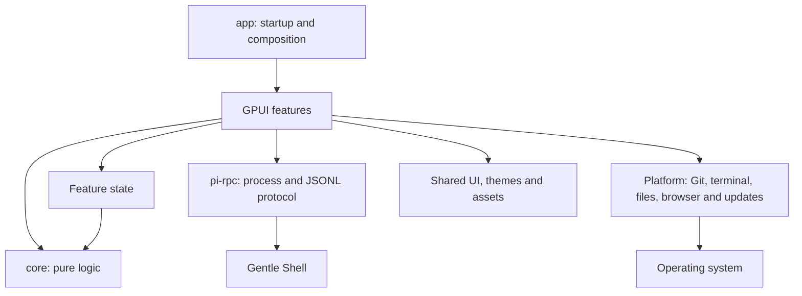
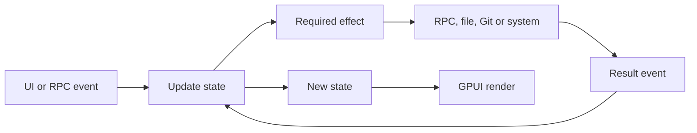

# Architecture

Gentle Shell GPUI is a native desktop application written in Rust. Its architecture is a **modular monolith by feature**: it ships as a single application, but keeps explicit boundaries between the UI, pure logic and external integrations.

## Goals

- Preserve observable behavior during refactors.
- Give each feature a small public API and private internal details.
- Separate pure rules and transformations from GPUI, processes, files and operating system APIs.
- Avoid abstractions without a current need: no crate per screen, and no trait with a single implementation just to simulate decoupling.
- Allow deterministic tests of state, transitions, parsers and edge cases.

## Current components



| Component | Responsibility |
| --- | --- |
| `crates/app` | Binary, composition, feature state, GPUI views, and the effects (files, processes, sound) of the logic that lives in `core`. |
| `crates/core` (`gentle-core`) | Pure logic with no GPUI or IO: transcript and subagent activity models, tool summaries, permission mode, jobs and ODD phase, `/` command routing, `notifications.json` policy, usage and statistics models, and the profile and model routing model. |
| `crates/pi-rpc` | Backend resolution and launch, JSONL transport, authentication and protocol types. |
| `packaging` | Packaging and distribution integration per operating system. |

`crates/pi-rpc` is a stable boundary: it knows nothing about GPUI, windows, tabs or visual components. `crates/app` depends on it, never the other way around.

`crates/core` depends on nothing in the project (neither `app` nor `pi-rpc`) and not on GPUI; its only dependencies are `serde`, `serde_json`, `regex`, and `hmac` and `sha2` (gentle-stream's handshake). It compiles the same on macOS, Windows and Linux: it contains no platform-specific code except the syntax of the policy's `file:` paths, chosen with `cfg!(windows)` at compile time. When a module mixed pure logic and effects, the pure part lives in `core`, and the effectful part stays in `app` and calls it:

| `core` | Stays in `app` |
| --- | --- |
| `transcript`, `activity`, `tools`, `commands` | `session/agents.rs`: `now_ms` (system clock). |
| `devices`: the device hub's list (plus AVDs it hasn't seen), launch-intent and device-command detection in agents' shell commands | `devices/`: the hub process and API, the panel (tabs, docked or floating, web viewer per device), `gentle-device`, the agents' instructions, SDK and simctl discovery. |
| `scroll`: row weights from content, the scroll estimate for rows not laid out yet, the steady thumb rule | `session/view/rail.rs` and `transcript_list.rs`: recording on-screen row heights, drawing the rail. |
| `music`: gentle-stream's wire protocol (frames, HMAC challenge and answer), its runtime folder, the player's state and the mood helper's answer | `music/`: the Unix socket, the Python helper, polling, the ♪ popover; `setup/music.rs`: finding and installing the player. |
| `web`: http(s) URL extraction, loopback filtering and log punctuation | `browser/` and session events: in-app browser card and `WebSurface`; `platform/shims.rs` writes the `gentle-open` and `gentle-device` shims. |
| `gentle_state`: `PermissionMode`, jobs, phase inference | `shared/gentle_state.rs`: reading and saving `permission-mode.json`. |
| `notifications`: `Alert`, policy validation and changes; `alert_timing`: `Gate` and `ContextLatch` | `alerts/`: file cache and writing, playback, bundled tones, notifying the window. |
| `text::first_line` | `shared/ui.rs`: the remaining presentation utilities. |
| `usage`: subscription window models and parsers (Codex, NaN), grouping, account claim; session records, statistics aggregation, ISO dates and civil days | `usage/`: reading `auth.json`, resolving keys (`$VAR`, `!command`), HTTP requests, walking and caching session files, clock and local time offset. |
| `profiles`: routing model, `profiles.json` format, pins, agent frontmatter, notes | `profiles/`: homes and agent discovery, atomic writes, saved and materialized routing, Pi settings, pin and worktree files, Make default. |
| `hydration`: the water reminder's settings (`hydration` in the app's `settings.json`) and when the next one is due | `hydration/`: the clock from launch, the timer, saving the setting, the drops animation. |
| `fuzzy`: fuzzy scoring and file ranking | `palette/`: walking files, reading branches with git. |
| `sessions`: session summary, folder name from cwd, ordering, ISO dates and relative time | `sessions/`: finding and reading `.jsonl` files (line scanning is tied to reading), cache. |
| `git`: status parsers (v1 and v2), numstat, refs, stash, worktrees (and where a new one goes), submodules, ahead/behind; diff trimming | `git/`: running `git`, counting lines of untracked files, stage, commit, push and branch operations. |
| `version`: stable versions, comparison and Gentle Shell update offer | `updates/`: launcher cache, npm query, clock. |
| `engram`: observation model and query encoding | `memory/`: HTTP requests to Engram. |
| `workspaces`: unique workspace names | `workspaces/`: saved model (uses `PaneTree`), reading and writing `workspaces.json`. |

## Layout

```text
crates/
├── app/
│   └── src/
│       ├── main.rs              # startup: CLI, single instance, toolchain PATH, config adoption
│       ├── app/                 # composition root (mod.rs): GPUI, themes, shortcuts, menus, window; integration.rs registers panels and sidebar
│       ├── cli.rs               # arguments (`[FOLDER] [-p TEXT]`) and initial folder
│       ├── features/            # one folder per feature; its entry point is mod.rs
│       │   ├── session/  workspace/  workspaces/  sessions/  palette/  profiles/  settings/  usage/  setup/
│       │   ├── browser/  devices/  music/  files/  terminal/  git/  providers/  memory/  onboarding/  notices/  alerts/  hydration/
│       │   └── app_update/  updates/  welcome/
│       ├── platform/            # OS integration: single instance, agent command shims, Dock and window icons
│       └── shared/              # pieces used by several features, with no logic of their own:
│                                # ui, floating, themes, assets, banner, surge, pane, gentle_state
├── core/                        # shared pure logic (gentle-core)
└── pi-rpc/
```

Paths follow the folder: `crate::features::session`, `crate::shared::ui`, `crate::platform::instance`. Each feature is a `features/<name>/` folder: `mod.rs` keeps its public types and API, and child modules add `impl` blocks and mark what they share as `pub(super)`. A new feature goes in `features/` as a folder even if it starts as a single file; something moves to `shared/` only when more than one feature uses it and it has no product logic.

`core` grows one complete behavior at a time and only with pure logic; anything that needs IO, processes, the clock or GPUI stays in `app` and calls `core`. No traits or adapters are introduced just to move something into `core`.

## Anatomy of a feature

A large feature can be split by responsibility:

```text
feature/
├── mod.rs          # public API and coordination
├── state.rs        # its own state and models
├── update.rs       # pure transitions, if any
├── effects.rs      # processes, network, files and async tasks
└── view/           # render and purely visual state
```

This shape is a guideline, not a mandatory template. A small feature should stay a single module.

### Current session boundary

`SessionView` is a tab: one `gentle-shell --mode rpc` backend and its conversation. Its logic is split by responsibility into `impl SessionView` blocks in sibling modules; `session/mod.rs` keeps the struct, the constructor, the public API used by the window (`workspace/mod.rs`), notifications to the window (`SessionEvent`, `sync_chrome`), actions and module wiring:

```text
session/
├── mod.rs          # SessionView, constructor, public API, actions and window utilities
├── state.rs        # groups of fields that change together and their pure transitions
├── events.rs       # RPC events, extension UI requests, stderr/output and Git refreshes
├── rpc.rs          # request/response, state read from the backend and commands (model, compact, export, sessions, prompts)
├── lifecycle.rs    # startup, restart (now or at end of turn), resume and conversation reset
├── submit.rs       # composer submission: `!` shell, built-ins, native screens and attachments
├── agents.rs       # agents panel
├── builtins.rs     # command classification and capture of extension output (pure)
├── attachments.rs  # image validation, tokens and payload (pure)
└── view.rs, view/  # render (see below)
```

`state.rs` groups the backend and its lifecycle (`Backend`: process state, version, stderr, pending prompt and session, pending restart), models and thinking level (`Models`), usage and compaction (`Usage`), extension UI (`ExtensionUi`: dialogs, statuses, widgets, usage limits and recent toasts), turn activity (`TurnActivity`: phase, queue, jobs and helpers), the todo island (`TodoIsland`) and Git state (`GitStatus`). Event interpretations that don't need GPUI (phase and jobs of a tool call, queue count, Gentle Design canvas, level of a `notify`) are pure functions or methods with tests in `events.rs`; effects (requests, timers, notifications) stay in `SessionView` methods.

### Current session view boundary

`session/view.rs` keeps the composition (`Render`), the sync of what is derived from the conversation (`sync_view`, rendered Markdown), the rendering of conversation items (tool cards, thinking, messages, notices) and the pieces shared by several views. Each visual responsibility of the composer and the conversation lives in a child module that exposes to the view only the API it needs:

```text
session/
├── view.rs                   # Render, conversation rows and shared pieces
└── view/
    ├── live.rs               # timers and transient visual state
    ├── transcript_list.rs    # rows, measurements and caches of the virtualized list
    ├── cards.rs              # extension custom message cards
    ├── composer.rs           # composer: context line, attachments, text and bottom bar
    ├── activity.rs           # activity line and status chips (jobs, widgets, usage, helpers, limits)
    ├── slash_menu.rs         # `/` command menu and its keyboard handling
    ├── model_picker.rs       # model picker, search and keyboard handling
    ├── effort.rs             # effort control (thinking level) and its slider
    ├── permissions.rs        # permission mode chip and picker
    ├── dialogs.rs            # extension dialogs and their keyboard handling
    └── todo_island.rs        # todo island over the conversation
```

`transcript_list.rs` owns the row shape, the computation of partial updates, the cache of prepared data and the GPUI list state. `view.rs` decides what content to render for each row, but does not directly modify the list's internal structure.

Child modules add their own `impl SessionView` blocks; what another module consumes is marked `pub(super)`, and what `session/mod.rs` uses is marked `pub(in crate::features::session)` or re-exported from `view.rs`. The width constants (`NARROW`, `TINY`), the collapse states and the shared pieces (`clock`, `image_tile`, `number_badge`) stay in `view.rs`.

### Other split features

Each one keeps its public type and API in the parent file; child modules add their own `impl` blocks and mark what they share as `pub(super)`.

```text
workspace/mod.rs     # Workspace, types (Pane, Tab, Space, Overlay) and public API
workspace/
├── layout.rs       # pane split calculations, tiling direction, drop zones
├── panes.rs        # create, split, focus and close panes
├── closed.rs       # reopening closed panes and tabs where they were
├── spaces.rs       # named workspaces
├── tabs.rs         # tabs and renaming
├── persistence.rs  # snapshot and saving
├── actions.rs      # shortcut handlers
├── overlays.rs     # overlay screens, palette and max animation
├── stages.rs       # web and device cards, tiling, the title bar's instance tray
├── view.rs         # title bar, tabs and panes
└── render.rs       # impl Render

profiles/mod.rs      # ProfilesView, ProfilesEvent, state and queries
profiles/
├── env.rs          # homes, gentle-pi package and agent discovery
├── files.rs        # atomic writes, profiles.json, models.json, settings.json, loading
├── pins.rs         # repository pins (files and Git worktree)
├── apply.rs        # route materialization, orchestrator and Make default
├── draft.rs        # draft edits (model, effort, tier)
├── actions.rs      # store actions and exit, name and delete flows
├── tests.rs        # file effect tests
└── view.rs, view/  # Render; cells, table, profile_list, confirm, footer

usage/mod.rs         # UsageView, state, refreshes and public API
usage/
├── credentials.rs  # auth.json → cards and requests; key resolution
├── fetch.rs        # usage HTTP requests
├── stats.rs        # session files: walking, reading, cache
└── view.rs, view/  # Render; subscription, stats

settings/mod.rs      # SettingsView, SettingsEvent, loading and screen composition
settings/
├── layout.rs       # row, section, or_dash
├── snapshot.rs     # reading the configuration and launcher probes
├── claude.rs       # Claude Code session and bridge plan
├── background.rs   # background subagents policy and Gentle AI section
├── upgrade.rs      # gentle-shell upgrade, its result and the card
├── packages.rs     # install and remove packages
└── notifications.rs, theme.rs, app.rs, models.rs  # one section each

palette/mod.rs       # PaletteView, actions, events, categories
palette/
├── commands.rs     # screens, panel commands and backend `/` commands
├── sources.rs      # files under the root and local branches
├── rows.rs         # rows and groups for the query and category
├── keyboard.rs     # selection, run row, categories, rename workspace
└── view.rs         # Render

sessions/mod.rs      # SessionsView, SessionsEvent, Scope
sessions/
├── discovery.rs    # sessionDir and .jsonl files per folder or all
├── summary.rs      # lightweight JSONL scan and per-file cache
├── view.rs         # state and actions
├── render.rs       # rows, list and Render
└── tests.rs        # tests with temporary session files

git/mod.rs           # run git, toplevel; re-exports the types callers use
git/
├── snapshot.rs     # changes for the panel and the tree
├── changes.rs      # Changes tab: stage, discard, stash, commit, push
└── refs.rs         # Branches tab: branches, stash, remote checkout, worktrees (add, remove, prune)

app_update/mod.rs    # AppUpdate (Global), Status, Problem; check, install, skip, restart
app_update/
├── release.rs      # versions, per-OS asset, release and SHA256SUMS parsing, decision
├── cache.rs        # app-update.json: 6 h cache and skipped version
├── network.rs      # fetch the release, download with sha256 and progress
├── archive.rs      # safe zip and tar.gz extraction; per-OS payload
├── install.rs      # replace the bundle (macOS), the file (Linux) and the running exe (Windows)
└── relaunch.rs     # process that reopens the app on exit

providers/          # mod.rs: types and constructor; login.rs (login helper and flow), list.rs, flow_view.rs, render.rs
onboarding/         # mod.rs: state and API; checks.rs (install plan, tones), install.rs, view.rs
notices/            # mod.rs: Notice, Notices; store.rs (push, read, limit), bell.rs, panel.rs
memory/             # mod.rs: MemoryView; client.rs (HTTP to Engram), view.rs
alerts/             # mod.rs: fire, context_threshold; policy.rs, sound.rs, tones.rs
updates/            # mod.rs: check and skip; cache.rs (launcher config), registry.rs (npm)
workspaces/         # mod.rs: saved model; store.rs (workspaces.json), tests.rs
```

## Data flow



Effects must not hide state changes. Results return to the feature so it decides how to represent them.

## Dependency rules

1. `pi-rpc` **does not depend** on `app` or GPUI.
2. `app` may depend on `pi-rpc` and `core`; the reverse direction is forbidden.
3. `core` **does not depend** on anything in the project (`app`, `pi-rpc`), nor on GPUI, the filesystem, processes, the clock or system APIs.
4. A feature consumes another through its public API; it does not access its private modules.
5. Shared UI code contains no business rules and knows nothing about specific features.
6. Integration with the operating system, processes and files stays at the edges.
7. Types stay private unless they are part of a real contract between modules.
8. No trait is introduced until there is a boundary that needs substitution, several implementations, or a test that cannot be solved with a pure function.
9. Splitting a file by size is not enough: each extracted module must have a nameable, cohesive responsibility.
10. Every refactor preserves behavior. When behavior is not covered, add a relevant characterization test first.

## Testing strategy

- **Pure logic:** unit tests for transitions, precedence, limits and errors.
- **Parsers and protocol:** representative inputs, incomplete data and invalid records.
- **Integrations:** tests at the edge, or a smoke test that runs the real path.
- **UI:** test state and observable decisions; don't test that a function merely delegates or copies fields.

Before completing a stage, run formatting, tests, Clippy and a smoke test of the modified path. If the environment does not allow a check, document it explicitly; don't assume it passed.

## How to add a feature

1. Find the feature that owns the behavior.
2. Put state, events and view there while they stay cohesive.
3. Extract pure logic into its own module when it can be tested without GPUI or IO.
4. Use `pi-rpc` or a platform module for external effects; don't duplicate the transport or system detection.
5. Expose from `mod.rs` only what other modules consume.
6. Add tests that cover behavior prone to regression.
7. Update this document or create an ADR if a boundary or a dependency rule changes.

## Related decisions

- [ADR-0001: Modular monolith by feature](adr/0001-modular-monolith.md)
- [ADR-0002: Incremental pure core](adr/0002-incremental-pure-core.md)
- [ADR-0003: Behavior-preserving refactors](adr/0003-behavior-preserving-refactors.md)
